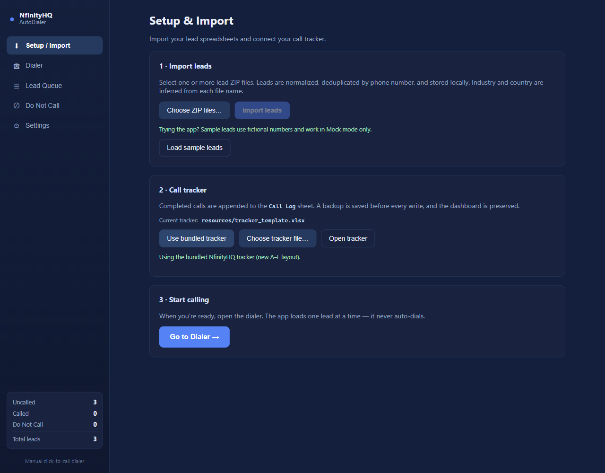

# NHQ AutoDialer

## Problem

Working through a lead list means moving between contact details, a calling tool, and a spreadsheet after every call. I wanted to keep that process in one desktop app so I could focus on the current lead and record the outcome before moving on.

I also wanted control over when each call starts, with a local Do Not Call list and a way to test the workflow without a paid phone account. Contact lists, phone numbers, and calling credentials needed to stay out of the public repository.

## Solution

I built NHQ AutoDialer to import lead spreadsheets, show one lead at a time, and open a call log when the call ends. I start each call myself, save the result to SQLite and an Excel tracker, and choose when to load the next lead. Do Not Call checks run before dialing, and retrying a tracker save does not create another copy of the call.

The app includes Mock mode for trying the full workflow and a Telnyx WebRTC integration for real calls. The public version includes fictional sample contacts and generates a blank tracker. Credentials and caller ID are entered locally and encrypted on disk; real leads, call history, and private workbooks are not bundled with the source.



## Stack and Explanation

| Part of the source | Stack | What it does and why |
| --- | --- | --- |
| `src/main/index.ts` | Electron 44, TypeScript | Creates the desktop window, manages startup and permissions, and handles single-instance behavior. Electron provides file and microphone access around the web interface. |
| `src/renderer/src/` | React 18, TypeScript/TSX, HTML, CSS | Separates the dialer, import, queue, settings, and logging screens. Shared call state keeps the selected lead and call log together. |
| `src/preload/`, `src/shared/` | Electron contextBridge/IPC, TypeScript | Exposes a typed API between React and the main process without giving the renderer direct Node access. IPC requests are restricted to the main window. |
| `src/main/db.ts`, `store.ts` | SQLite, sql.js/WebAssembly, SQL | Stores leads, calls, settings, and Do Not Call entries locally. WebAssembly avoids a native database compiler in the Windows build. |
| `src/main/services/importer.ts` | adm-zip, ExcelJS | Reads lead workbooks from archives, deduplicates valid numbers, and rolls back failed batches. Size and row limits bound imports. |
| Phone and location services | libphonenumber-js, TypeScript | Normalizes numbers to E.164 and estimates calling hours from state/province timezones. Normalization makes duplicate and Do Not Call checks consistent. |
| `src/main/services/excel.ts` | ExcelJS, Node filesystem APIs | Preserves tracker sheets and formatting, backs up writes, and uses submission IDs to avoid duplicate exports. |
| `services/callingProvider/` | Mock adapter, Telnyx WebRTC SDK | Keeps call control separate from the screens. Telnyx uses a SIP connection without a separate hosted token server; Mock mode needs no account. |
| Private settings | Electron safeStorage | Uses operating-system encryption for SIP credentials and caller ID before saving them. Values are only decrypted locally when needed. |
| Build scripts and tests | electron-vite, Vite, electron-builder, esbuild, Node assert | Builds main/preload/renderer code, generates the blank tracker, packages Windows executables, and runs isolated integration checks. |

The app uses TypeScript for logic, TSX for React components, CSS for styling, SQL for queries, and small JavaScript build scripts. There is no hosted REST backend. React calls the preload API in `src/shared/api.ts`; the main process handles imports, storage, settings, file dialogs, and tracker writes. Telnyx handles external signaling and voice media, with received audio connected to the renderer's audio element.

Use Node.js 22.12 or newer; Node 24 is the tested environment:

```powershell
npm ci
npm run dev
```

Start in **Mock** mode and choose **Load sample leads** on the setup screen. Those fictional numbers are blocked from Telnyx calling. Your own lead archives can contain `.xlsx` workbooks with Business, Owner, Phone, Website, Location, and Revenue headers. Invalid numbers remain visible for review but cannot be dialed.

For live calls, configure a Telnyx credential-based SIP connection, an outbound voice profile, and an authorized caller ID. Enter the SIP username, password, and caller ID in Settings, then save and connect. Windows must allow desktop microphone access. This version uses SIP credentials rather than a Telnyx REST API key; no live credentials are stored in source files.

User data stays in Electron's `userData` folder, shown in Settings and normally under `%APPDATA%` on Windows. It contains the SQLite database, working tracker, and backups. Close the app before backing it up. `NHQ_AUTODIALER_DATA_DIR` selects an isolated workspace. If Excel locks the tracker, close the workbook and retry the save.

```powershell
npm run typecheck
npm test
npm run build
npm run build:win
npm audit
```

The 14 integration checks pass, and the packaged Windows app was exercised through a Mock call, logging, tracker failure/retry, Do Not Call, restart persistence, and shutdown. `release/` holds generated installer and portable builds; they are excluded from Git. Live Telnyx calls and audio quality have not been verified with a paid account. Windows packages are unsigned, and macOS/Linux packages are unverified. Calling hours are a regional estimate, not an exact location lookup.
